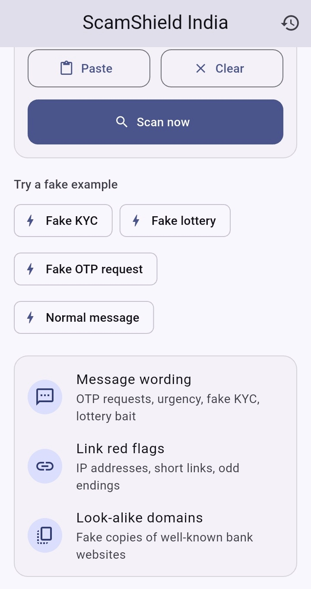
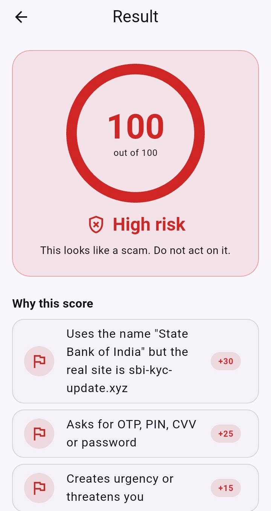
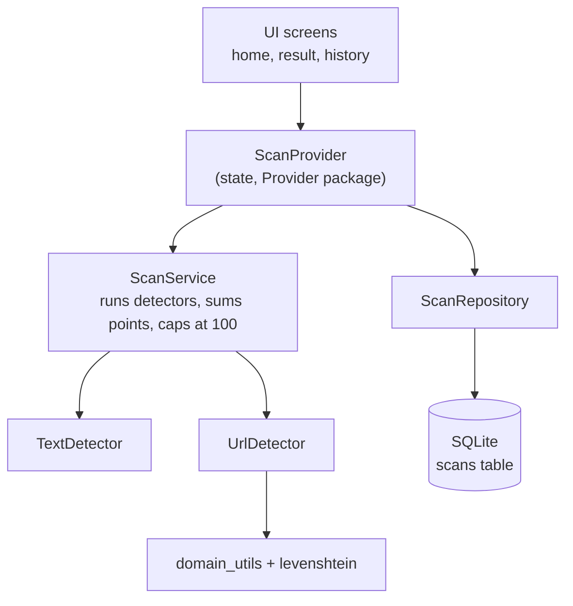

# ScamShield India


A Flutter app that checks a suspicious SMS or link and returns a **0-100 risk
score**, a verdict, plain-English reasons, and what to do next.

- Runs **fully on your phone**. No server, no account, no machine learning.
- Uses **transparent weighted rules**. Every point in the score is explained.
- Built for scams common in India: fake KYC messages, UPI collect requests,
  fake bank links, lottery and cashback bait.

> This app gives a risk estimate, not a guarantee. It cannot catch every scam,
> and a low score does not mean a message is safe. Never share your OTP, PIN
> or CVV with anyone.

## Screenshots

All messages shown are fake examples written for testing.

<p align="center">
  
  
  
  
  
</p>

From left to right: home, home scrolled down, high risk result, likely safe
result, history.

## Features

- Paste a message or link, or tap **Paste** to read your clipboard. The
  clipboard is read only when you tap the button.
- Tap a **fake example** chip to try the app without typing.
- Result screen with an animated score ring, a verdict, every reason with its
  points, and next steps (helpline **1930**, **cybercrime.gov.in**).
- A warning when one of the checks could not run, so a crash never looks like
  "safe".
- Scan history with a delete-all button. Tap an entry to see its reasons.

## How the score works

Each rule that matches adds points. The total is capped at 100, and the reasons
are shown from the biggest contribution to the smallest.

| Score  | Verdict     |
| ------ | ----------- |
| 0-29   | Likely safe |
| 30-59  | Suspicious  |
| 60-100 | High risk   |

**Worked example.** The fake message
`Your cashback is ready. Check details at www.freeoffer-deals.top` scores 40:

| Reason                                  | Points |
| --------------------------------------- | ------ |
| Claims a prize, lottery or cashback     | +20    |
| Link has a suspicious ending (`.top`)   | +15    |
| Contains a link                         | +5     |
| **Total** (Suspicious)                  | **40** |

### Message text rules

| Rule                                  | Points | Example trigger (fake)                    |
| ------------------------------------- | ------ | ----------------------------------------- |
| Asks for OTP, PIN, CVV or password    | +25    | "share otp", "your upi pin"               |
| Creates urgency or threatens you      | +15    | "urgent", "suspended", "will expire"      |
| Claims a prize, lottery or cashback   | +20    | "you have won", "lucky draw"              |
| KYC or account verification request   | +20    | "update kyc", "kyc expired"               |
| UPI collect / money request           | +20    | "collect request", "pay 1000", "send rs 500" |
| Legal / arrest threat                 | +20    | "arrest warrant", "court notice"          |
| Asks you to call a number             | +10    | "call this number"                        |
| Contains a link                       | +5     | "http://..." or "www...."                 |

How some rules avoid false alarms:

- Warnings such as "do not share your OTP" are excluded from the OTP rule, so
  genuine bank reminders are not flagged.
- The urgency rule matches phrases ("will expire", "has expired", "is expired"),
  not the bare word "expired", so "meeting invite expired" is not flagged.
- The money rule matches `pay`, `send` or `transfer` followed by an amount, with
  or without "Rs". A promise directly before the verb ("I will pay Rs 500") is
  ignored.
- "Your KYC expired" is counted once (as a KYC request), not twice.

### Link rules

The app finds every link in the message and scores each one separately. Only
the **highest-scoring link** counts, so five links do not add up to five times
the points.

| Rule                                                          | Points |
| ------------------------------------------------------------- | ------ |
| Looks like a fake copy of a known brand domain (1-2 typos)    | +35    |
| Brand name in the link, but the real site is a different one  | +30    |
| Uses an IP address instead of a website name                  | +25    |
| Contains punycode (`xn--`), which can hide look-alike letters | +25    |
| Has an `@` symbol (the real site is the part after it)        | +20    |
| Shortened link (bit.ly and similar)                           | +15    |
| Suspicious ending: `.xyz`, `.top`, `.click`, `.icu`           | +15    |
| Domain has 2 or more hyphens                                  | +10    |
| More than 3 subdomains                                        | +10    |
| Link starts with `http://` (not HTTPS)                        | +10    |
| Link is longer than 75 characters                             | +5     |

**Look-alike detection.** The app compares the **first label** of the link's
main domain (for example `sbi` in `sbi.co.in`) with the same part of each
official domain, using the Levenshtein edit distance: the number of
single-letter changes (insert, delete, replace) needed to turn one word into
another. Names of 5 letters or fewer allow 1 change, longer names allow 2. So
`sbl.co.in` is flagged as a copy of `sbi.co.in`, `hdfcbnak.com` is flagged as a
copy of `hdfcbank.com`, and an unrelated name such as `abc.co.in` is not. The
ending (`.com`, `.co.in`) is ignored in this comparison. The Levenshtein
function is written from scratch, without a package.

**Brands covered:** State Bank of India, HDFC Bank, ICICI Bank, Axis Bank and
Paytm. The official domains are listed in `lib/detectors/url_rules.dart`.

## Architecture



### Folder structure

```
lib/
  core/        detector.dart              Detector interface, Finding, DetectionResult
  detectors/   text_rules.dart            keyword rules as data
               text_detector.dart
               url_rules.dart             brands, shorteners, TLD lists as data
               url_detector.dart
  services/    scan_service.dart          runs all detectors, builds the score
               domain_utils.dart          extract host, registrable domain, subdomains
               levenshtein.dart           edit distance, written by hand
  data/        app_database.dart          opens the SQLite database
               scan_repository.dart       save, get all, delete all
               scan_record.dart           one saved scan
  providers/   scan_provider.dart         state shared with the screens
  ui/screens/  home, result, history screens
test/          unit tests for detectors, utilities, service, provider,
               record and repository
```

### Design decisions

- **Strategy pattern.** Every analyzer implements the same small interface:

  ```dart
  abstract class Detector {
    String get name;
    List<Finding> analyze(String input);
  }
  ```

  `ScanService` receives a list of detectors, so a new analyzer can be added by
  writing one new class and adding it to the list. The existing detectors do not
  change.
- **Failure isolation.** `ScanService` wraps each detector call in `try/catch`.
  If one detector throws, the others still run, the failure is counted in
  `DetectionResult.failedChecks`, and the Result screen shows a warning.
- **Rules are data, logic is code.** Keywords, brands and lists live in
  `text_rules.dart` and `url_rules.dart`. Changing a rule does not touch the
  matching code.
- **Explainable by design.** A `Finding` is a reason plus points. The score is
  only the sum of findings, so the screen can always show why.
- **Testable database.** `AppDatabase` takes an optional path, so tests can use
  an in-memory SQLite database while the app uses the real file.
- **On-device only.** No message is sent anywhere.

## Privacy design

- Analysis happens on the phone. The app does not upload your message.
- History stores only a **preview of the first 100 characters**, the score, the
  verdict, the reasons and the time. The full message is not saved.
- The History screen has a **delete all** button.
- The app does not read your SMS inbox. You paste what you want to check.

Limits of this design: the database is **not encrypted**, and a 100-character
preview can still contain a phone number or part of an OTP. Do not paste
messages you are not comfortable having on your phone.

## Tests and CI

- **119 unit tests** across 8 files: text detector, URL detector, domain
  utilities, Levenshtein, scan service, scan provider, scan record and scan
  repository.
- Repository tests run against an in-memory SQLite database
  (`sqflite_common_ffi`, a dev-only dependency).
- Fixed bugs were first reproduced with a failing test, and a "guard" test
  checks that the fix did not stop real scams from being caught.
- GitHub Actions runs `flutter analyze` and `flutter test` on every push and
  pull request to `main`, using a pinned Flutter version (3.44.9).
- Tests use made-up messages only.

## Run it yourself

Requirements: Flutter 3.44.9 (stable) and an Android phone with USB debugging.

```powershell
git clone https://github.com/IMxPratham/Scam-Shield-India.git
cd Scam-Shield-India
flutter pub get
flutter analyze
flutter test
flutter run
```

Run the app on a real Android device. The history screen uses `sqflite`, which
does not work in a web browser.

## Known limitations

This is a rule-based tool, so it is easy to fool and it makes mistakes. These
are the problems I know about. Items marked "not tested" were reasoned from the
code and are not covered by a test.

**Message text rules**
- Rules match exact phrases. Rewording (for example "update your KYC" instead of
  "update KYC", or "your KYC is expired") can slip past them. "Your offer
  expired" is also missed, because only threat phrases are matched.
- The money rule flags any `pay`, `send` or `transfer` followed by a number, so
  harmless messages such as "pay 500 for the pizza" are false positives.
- The "do not share" exception looks at the whole message, so a scammer could
  add that phrase to hide a request for an OTP.
- Single words such as "blocked" and "suspended" can cause false positives, for
  example "road blocked" (not tested).
- Fee-for-reward wording such as "token" or "processing fee" is not a rule. A
  message like "Pay 1000 for token and win" is caught only by the money rule.
- The text "contains a link" rule only sees `http://`, `https://` and `www.`,
  so bare domains are missed there.
- Conversational scams with no link and no trigger words (a friendly
  "wrong number" hook, a fake boss asking for a payment, a fake job offer) are
  not detected, because there is nothing for a keyword rule to match (not
  tested).
- The rules and brand list are written for Indian scams. Messages that mention
  services such as USPS, IRS or Zelle mostly score low, apart from generic words
  such as "urgent" (not tested).

**Link rules**
- Only 5 brands are covered. The official domain lists have **not been
  independently verified in a browser**, so do not treat them as complete.
- Look-alike detection compares only the first label of the domain, so the
  ending is ignored. Short names can also match by chance, and a domain such as
  `bank.sbi` has the name part `bank` (not tested).
- Not detected: hidden IP forms such as `http://3232235777`, bare IP addresses
  without `http://`, and brand names without separators such as `sbikyc.xyz`.
- The "no HTTPS" rule only fires when the link starts with `http://`.
- A bare token with a capital letter right after a dot (such as `now.Click`) is
  treated as a typo, not a link. This stops `Pay now.Click here` from being read
  as a `.click` link, but a scammer could use mixed case to avoid the link
  rules (not tested).
- A brand name in the path of a legitimate news page adds +30. This is a
  documented behaviour, because a phishing page and a news page look the same
  to this rule.
- Domain handling covers common Indian suffixes such as `co.in`. Suffixes from
  other countries are not handled.
- One link can be counted by both the text rule (+5) and the link rules.

**Engineering**
- The database is not encrypted.
- If a detector throws an error, the scan continues with the remaining checks
  and the Result screen shows a warning. History does not record that a check
  failed.
- There are no automated tests for the screens (widget tests).
- Tests that check exact totals must be updated whenever points change.

## Not built yet

- Opt-in link expander that follows short links. Expanding a link contacts the
  scammer's server, so it will be off by default and clearly explained.
- About screen and dark mode.
- Verifying the official brand domains in a browser, and adding more brands.

## What to do if you receive a scam

- Do not click the link, call the number or share any OTP, PIN or CVV.
- Report cyber fraud on the national helpline **1930** or at
  **cybercrime.gov.in**.
- If money was taken, call your bank immediately.

## Ethics and scope

ScamShield India is a defensive tool. It only analyzes text you paste in. It
does not read your inbox, scan networks or interact with other systems.

---

Built by [IMxPratham](https://github.com/IMxPratham) as a learning project in
mobile security and clean software design.